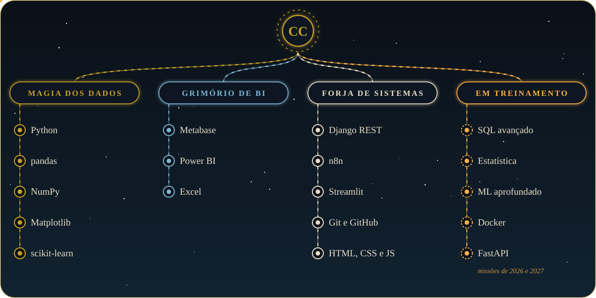
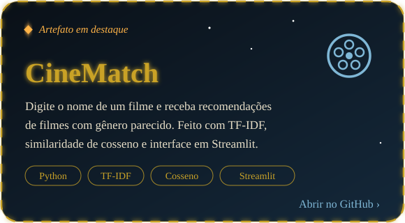
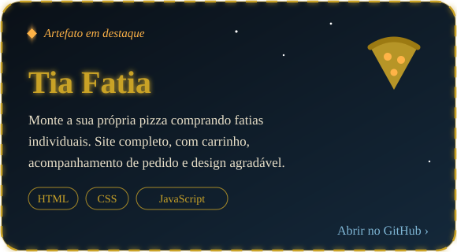

<!-- Cabeçalho -->
<div align="center">
  
</div>

<div align="center">
  
</div>

<div align="center">
  
</div>

## 📜 Ficha de herói

```text
╔══════════════════════════════════════════════╗
║         F I C H A   D E   H E R Ó I          ║
╠══════════════════════════════════════════════╣
║  Nome    ... Cláudio Carvalho                ║
║  Classe  ... Mago de Dados (Analista)        ║
║  Origem  ... João Pessoa, Paraíba            ║
║  Guildas ... UEPB e Unipê                    ║
║  Arma    ... Python                          ║
║  Foco    ... BI e Machine Learning           ║
║  Estado  ... Pronto para a próxima missão    ║
╚══════════════════════════════════════════════╝
```

> *"Na prática é que se aprende."*

**📍 Origem.** Tudo começou na infância, vendo meus familiares usarem e jogarem no computador e me perguntando como aquilo tudo funcionava. Aos 15 anos, na escola, conheci a programação com C++ e entendi que dava para criar as minhas próprias soluções. Desde então não parei.

**🏰 Treinamento.** Passei por duas guildas: a **Unipê**, onde concluí Análise e Desenvolvimento de Sistemas, e a **UEPB**, onde me formei em Ciência de Dados. No caminho, treinei na Fábrica de Software com Python, Django e Django REST Framework, e orientei os membros mais novos da equipe.

**⚔️ Aventuras.** No estágio da **UMTI**, construí dashboards no Metabase com indicadores de produtos e de faturamento, incluindo a comparação de preços entre estabelecimentos de João Pessoa. Na **SIAGOV**, criei fluxos de automação no n8n com IA para transformar documentos em Markdown e TXT e prepará-los para vetorização. E criei um sistema de recomendação de filmes com TF-IDF, similaridade de cosseno e Streamlit.

**🧭 Próxima missão.** Hoje treino SQL, estatística e Machine Learning enquanto construo três projetos de portfólio: BI, ML e deploy. Busco a minha primeira vaga como Analista de Dados, BI ou Cientista de Dados Júnior, e quem me der essa chance vai encontrar alguém que aprende na prática e gosta de entregar.

<div align="center">
  
</div>

<div align="center">
  
</div>

## 🌳 Árvore de habilidades

<div align="center">
  
</div>

### 📚 Grimório: onde cada habilidade foi forjada

| Habilidade | Ramo | Onde foi forjada |
|---|---|---|
| 🐍 **Python** | Magia dos Dados | Fábrica de Software e projeto de recomendação de filmes |
| 🐼 **pandas** | Magia dos Dados | Projeto de recomendação de filmes |
| 🔢 **NumPy e Matplotlib** | Magia dos Dados | Estudos de análise de dados, em prática |
| 🤖 **scikit-learn** | Magia dos Dados | Estudos de Machine Learning |
| 📊 **Metabase** | Grimório de BI | Estágio na UMTI e certificado da Udemy |
| 📈 **Power BI** | Grimório de BI | Projeto Olist (em andamento) |
| 📑 **Excel** | Grimório de BI | Nível intermediário |
| 🔗 **Django REST** | Forja de Sistemas | Treinamento na Fábrica de Software |
| ⚙️ **n8n** | Forja de Sistemas | Estágio na SIAGOV, com automação e IA |
| 🖥️ **Streamlit** | Forja de Sistemas | Projeto de recomendação de filmes |
| 🌿 **Git e GitHub** | Forja de Sistemas | Todos os projetos ficam versionados |
| 🎨 **HTML, CSS e JavaScript** | Forja de Sistemas | Projeto Tia Fatia |

**🔥 Em treinamento (as brasas da árvore):** `SQL avançado` · `Estatística aplicada` · `Machine Learning aprofundado` · `Docker` · `FastAPI`. São as missões de 2026 e 2027, e cada uma ganha um projeto como prova.

<div align="center">
  
</div>

## 👑 Projetos em destaque

Dois artefatos para você conhecer o meu trabalho. Clique em um card para abrir o repositório.

<div align="center">
  <a href="https://github.com/ClaudioCarv/CineMatch_Recommendations"></a>
  <a href="https://github.com/ClaudioCarv/Tia_Fatia"></a>
</div>

### 🎒 Outros artefatos do inventário

| Repositório | Linguagem |
|---|---|
| [Previsões de Energias Renováveis](https://github.com/ClaudioCarv/Previsoes-Energias-Renovaveis) | Python |
| [Análise de Dados: dataset de vendas](https://github.com/ClaudioCarv/Analise-de-Dados-Dataset-Dados_Vendas.csv) | Python |
| [Conversor de PDF para Markdown](https://github.com/ClaudioCarv/Conversor-PDF-to-MD) | Python |
| [Amizades com Neo4j](https://github.com/ClaudioCarv/amizades_neo4j) | Python |
| [Portfólio (este site)](https://github.com/ClaudioCarv/Portfolio) | CSS |

<div align="center">
  
</div>

## 🗺️ Diário de missões

**Missão principal:** conquistar a primeira vaga na área de dados.

| Missão | Descrição | Status |
|---|---|---|
| **A Cidade do Comércio** | Análise de e-commerce (Olist): SQL, Python e dashboard em Power BI | 🚧 Em andamento |
| **O Oráculo das Previsões** | Machine Learning com problema de negócio e interpretabilidade | 🔜 Em breve |
| **A Torre do Deploy** | Pipeline de dados e modelo em produção (Docker, FastAPI e Streamlit) | 🔜 Em breve |

**Missões concluídas**

- ✅ **CineMatch:** sistema de recomendação de filmes com TF-IDF, similaridade de cosseno e interface em Streamlit ([ver repositório](https://github.com/ClaudioCarv/CineMatch_Recommendations))
- ✅ **Tia Fatia:** site de pizzaria criado em equipe no curso de desenvolvimento web ([ver repositório](https://github.com/ClaudioCarv/Tia_Fatia))
- ✅ **Estágio na SIAGOV (2026):** fluxos de automação no n8n com IA para preparar documentos para vetorização
- ✅ **Estágio na UMTI (2026):** dashboards no Metabase com indicadores de produtos e faturamento
- ✅ **Treinamento na Fábrica de Software (2023):** Python, Django e Django REST Framework
- ✅ **Duas formações concluídas:** Análise e Desenvolvimento de Sistemas (Unipê) e Ciência de Dados (UEPB)

<div align="center">
  
</div>

## 🏆 Atributos do herói

<div align="center">
  
</div>

<div align="center">
  
</div>

<div align="center">
  
</div>

## 🍺 A taverna (contato)

Viajante, se você tem uma vaga na área de dados, um projeto ou só quer trocar ideia, a taverna está aberta. Sentem-se, e vamos conversar.

<div align="center">
  <a href="https://www.linkedin.com/in/claudiocarvalho455/"></a>
  <a href="mailto:joseclaudiogt@gmail.com"></a>
  <a href="https://www.instagram.com/claudiio_carvalhoo/"></a>
</div>

<br/>

<div align="center">
  
  <br/>
  
</div>
